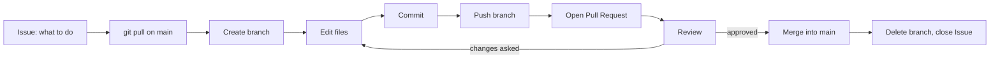
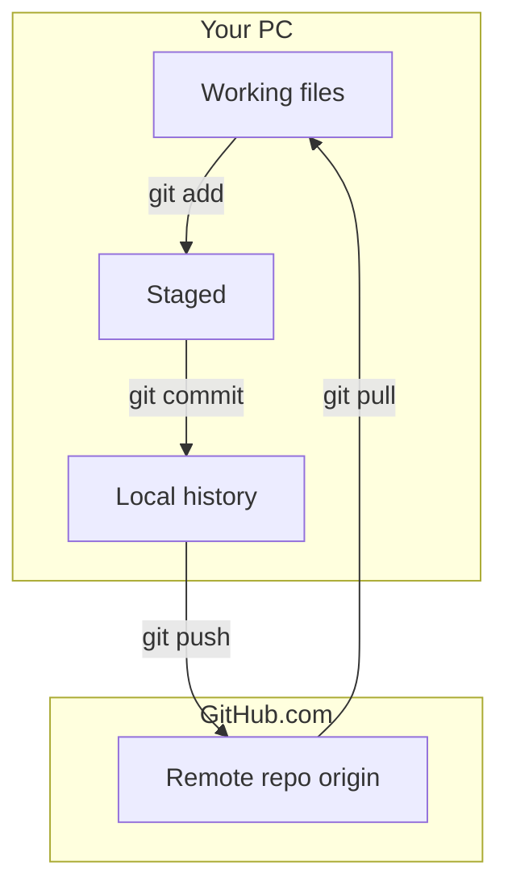

# Chapter 08 — GitHub End to End, Every Day

**Goal:** See the whole GitHub day in one place, then practice it week by week.

**Time:** about 1 hour to read, then 4 weeks of short practice  
**You need:** your GitHub account `ravi0123456`, the [hello-world](https://github.com/ravi0123456/hello-world) repo, Git and VS Code from [Chapter 02](02-daily-workflow.md)

This chapter joins together what you learned in chapters 01 to 05. If a word is new, look in [glossary.md](glossary.md).

---

## 1. The ten words you need

| Word | Simple meaning | Example |
|---|---|---|
| Repo | A project folder plus its full history | `hello-world` |
| Commit | One saved snapshot with a message | "Add contact section to README" |
| Branch | A safe copy of the work where you can change things | `fix-readme-typo` |
| `main` | The main, trusted branch | what everyone uses |
| Clone | Copy a repo from GitHub to your PC | `git clone ...` |
| Pull | Bring new commits from GitHub to your PC | `git pull` |
| Push | Send your commits from your PC to GitHub | `git push` |
| Pull Request (PR) | "Please look at my branch and add it to `main`" | PR #3 |
| Review | A teammate reads your PR and comments | "Looks good" |
| Merge | Join the branch into `main` | green **Merge** button |
| Issue | A to-do item, bug, or question | "README has a typo" |

---

## 2. The whole day in one picture



Read it left to right. Every task, big or small, follows this loop.

---

## 3. Step by step, with commands

### Step 1. Start from an Issue

On GitHub open the repo, click **Issues → New issue**.

- Title: `Add my favourite tools to README`
- Body: one or two lines on what "done" means.

The Issue gets a number, for example `#4`. Remember it.

### Step 2. Get the latest `main`

In VS Code terminal:

```text
git switch main
git pull
```

Why? Other people may have changed `main`. You want to start from the newest version.

### Step 3. Make a branch

```text
git switch -c add-tools-section
```

`-c` means "create". Use short names with dashes. Say what the work is.

### Step 4. Edit and commit

Change `README.md`. Then:

```text
git status
git add README.md
git commit -m "Add favourite tools section (#4)"
```

- `status` shows what changed.
- `add` picks the files for the snapshot.
- `commit` saves the snapshot. Writing `#4` links it to the Issue.

Small commits are better than one huge commit.

### Step 5. Push the branch

```text
git push -u origin add-tools-section
```

`-u` connects your local branch to the GitHub branch. Next time just `git push`.

### Step 6. Open a Pull Request

GitHub shows a yellow bar: **Compare & pull request**. Click it.

- Base: `main` (where it goes)
- Compare: `add-tools-section` (your work)
- Description: what you changed, why, and `Closes #4`

`Closes #4` will close the Issue automatically when the PR is merged.

### Step 7. Review

A reviewer reads the **Files changed** tab. They can:

- **Comment** — a question or idea
- **Request changes** — fix something first
- **Approve** — good to go

If changes are asked: edit, commit, push again on the **same branch**. The PR updates by itself.

### Step 8. Merge and clean up

Click **Merge pull request**, then **Delete branch**. On your PC:

```text
git switch main
git pull
git branch -d add-tools-section
```

Done. The Issue is closed. `main` has your work.

---

## 4. Where things live



Commit = saved on your PC only. Push = now on GitHub too.

---

## 5. Hands-on practice plan

Do each week in short sessions of 20–30 minutes. Use `hello-world`.

### Week 1 — Comfort on github.com

| Day | Exercise | Done when |
|---|---|---|
| 1 | Edit `README.md` on github.com, commit to `main` | You see the commit in **History** |
| 2 | Create an Issue "Add about-me section" | Issue #N exists |
| 3 | On github.com, create branch `about-me`, edit, commit | Branch shows 1 commit ahead |
| 4 | Open a PR from `about-me` to `main` with `Closes #N` | PR is open |
| 5 | Merge it, delete branch | Issue closed automatically |

### Week 2 — Same loop from your PC

| Day | Exercise | Done when |
|---|---|---|
| 1 | Clone `hello-world` in VS Code | Folder opens in VS Code |
| 2 | Branch, edit, commit, push (section 3 above) | Branch visible on GitHub |
| 3 | Open PR, merge, then `git pull` on `main` | PC and GitHub match |
| 4 | Add a `.gitignore` with `*.log` | A `test.log` file is not shown in `git status` |
| 5 | Edit README on github.com, then `git pull` on PC | You see the change locally |

### Week 3 — Working like a team

| Day | Exercise | Done when |
|---|---|---|
| 1 | Add labels `bug` and `docs`, put one on an Issue | Label visible |
| 2 | Open a PR, then add a review comment on your own line | Comment visible on the line |
| 3 | Push a second commit to the same PR after a comment | PR shows 2 commits |
| 4 | Create a merge conflict on purpose (edit the same line on two branches) and fix it | PR becomes mergeable |
| 5 | Turn on branch protection for `main` (require a PR) | Direct push to `main` is refused |

### Week 4 — Getting ready for CI/CD

| Day | Exercise | Done when |
|---|---|---|
| 1 | Read [Chapter 09 — YAML](09-yaml-basics.md); add `config/app.yml` | File is valid (see Chapter 09 check) |
| 2 | Read [Chapter 10 — Ansible and AWX](10-ansible-awx-basics.md) | You can explain playbook vs job template |
| 3 | Read [Chapter 11 — Jenkins and Groovy](11-jenkins-groovy-basics.md) | You can explain stage and credential |
| 4 | Read [Chapter 12 — GitHub + Jenkins + AWX](12-github-jenkins-awx-together.md); add the sample `Jenkinsfile` to a branch (do not connect it to a real Jenkins) | PR open with the file |
| 5 | Read [Chapter 13 — IDMC with GitHub](13-idmc-with-github.md) | You can draw Dev → QA → Prod on paper |

---

## 6. Common beginner mistakes

| Mistake | Fix |
|---|---|
| Working directly on `main` | Always `git switch -c new-branch` first |
| Forgot to `git pull` before starting | `git pull` on `main`, then make the branch |
| Huge PR with 30 files | Split into small PRs |
| Commit message "update" | Say what and why: "Fix typo in setup steps" |
| Password or token in a file | Never. Remove it, and revoke the token on GitHub |

---

**Next:** [Chapter 09 — YAML basics](09-yaml-basics.md)  
Back to the guide home: [README.md](README.md)
