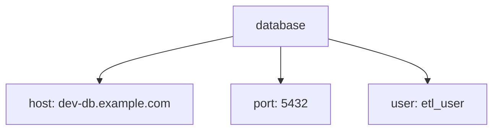

# Chapter 09 — YAML Basics

**Goal:** Read and write simple YAML files without fear.

**Time:** about 45 minutes  
**You need:** VS Code. Optional: Python on your PC for the check in section 7.

---

## 1. What is YAML?

YAML is a plain text file for **settings**. It is not a program. It does not "run". Other tools read it.

- Ansible playbooks are YAML.
- AWX and GitHub Actions use YAML.
- Our work `flo_dev.yml` is YAML (see [Chapter 06](06-idmc-cicd-picture.md)).

Files end with `.yml` or `.yaml`. Both are the same.

Think of YAML as a **form** you fill in: a label, a colon, then the value.

---

## 2. Key and value

```yaml
name: Ravi
team: Data Integration
years: 5
active: true
```

- `name` is the **key** (the label).
- `Ravi` is the **value**.
- There must be a **space after the colon**.

Types YAML understands:

| Example | Type |
|---|---|
| `Ravi` or `"Ravi"` | text (string) |
| `5` | number |
| `true` / `false` | yes/no (boolean) |
| `null` or `~` | empty |

Tip: put text in quotes if it has a `:` or `#` inside, or looks like a number you want as text, e.g. `version: "1.10"`.

---

## 3. Indentation = belonging

Spaces show what belongs to what. **Use spaces, never tabs.** Two spaces is normal.

```yaml
database:
  host: dev-db.example.com
  port: 5432
  user: etl_user
```

`host`, `port` and `user` belong to `database`.



If one line has 3 spaces and the others have 2, the file breaks.

---

## 4. Lists

A list item starts with a dash and a space.

```yaml
environments:
  - dev
  - qa
  - prod
```

A list of objects (very common in Ansible):

```yaml
users:
  - name: ravi
    role: admin
  - name: anu
    role: developer
```

Each `-` starts one new user. `name` and `role` line up under each other.

Short form (also valid):

```yaml
environments: [dev, qa, prod]
```

---

## 5. Comments and long text

```yaml
# This whole line is a comment. Tools ignore it.
owner: ravi   # comment at the end of a line

description: |
  This keeps
  each new line.

summary: >
  This folds the lines
  into one long line.
```

---

## 6. A real-looking example

```yaml
# deploy settings for a sample project
project: sales_pipeline
environment: qa
notify:
  email:
    - ravi@example.com
    - team@example.com
steps:
  - name: validate
    enabled: true
  - name: deploy
    enabled: true
    timeout_minutes: 30
```

Read it out loud: "Project is sales_pipeline. Environment is qa. Notify two emails. Two steps: validate and deploy."

---

## 7. Check your YAML

A broken YAML file is the #1 reason a pipeline fails early.

- **VS Code:** install the "YAML" extension (by Red Hat). Red lines show errors.
- **Command line** (if Python is installed):

```text
python -c "import yaml,sys; yaml.safe_load(open(sys.argv[1])); print('OK')" config/app.yml
```

(If it says `No module named yaml`, run `pip install pyyaml` first.)

- **yamllint** (used in the Jenkinsfile in Chapter 12): `pip install yamllint`, then `yamllint config/`.

---

## 8. Common mistakes

| Wrong | Right | Why |
|---|---|---|
| `name:Ravi` | `name: Ravi` | Space needed after colon |
| Tab before `host` | Two spaces | Tabs are not allowed |
| `-dev` | `- dev` | Space needed after dash |
| `password: MySecret123` | Do not store it | Secrets go in Jenkins/AWX credentials |
| `version: 1.10` | `version: "1.10"` | Without quotes it becomes number 1.1 |

---

## 9. Practice

1. In `hello-world`, create branch `yaml-practice`.
2. Add `config/app.yml` with your name, a list of 3 environments, and one nested `database` block.
3. Check it with the VS Code extension or the Python line above.
4. Break it on purpose (add a tab). See the error. Fix it.
5. Commit, push, open a PR.

---

**Next:** [Chapter 10 — Ansible and AWX basics](10-ansible-awx-basics.md)  
Back to the guide home: [README.md](README.md)
