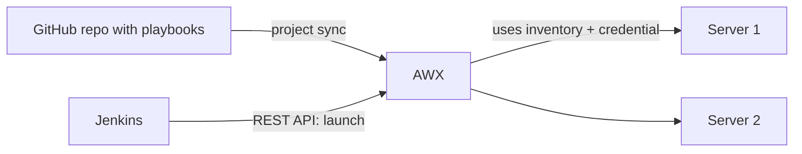

# Chapter 10 — Ansible and AWX Basics

**Goal:** Understand what Ansible and AWX do, and the five words you must know: playbook, inventory, credential, project, job template.

**Time:** about 1 hour  
**You need:** [Chapter 09 — YAML](09-yaml-basics.md) done

---

## 1. What is Ansible?

Ansible is a tool that **does jobs on servers for you**. Examples:

- copy a file to 10 servers
- install a package
- restart a service
- run a script, such as starting an Informatica Secure Agent

You write the steps once in a YAML file. Ansible connects to the servers (usually by SSH for Linux, WinRM for Windows) and does them. Nothing needs to be installed on the target servers except Python (Linux).

## 2. What is AWX?

AWX is a **website for Ansible**. It is the free, open-source version of Red Hat Ansible Automation Platform (older name: Ansible Tower).

With AWX you can:

- click a button to run a playbook
- keep passwords safe (credentials)
- see logs of every run
- let other tools (like Jenkins) start a run through a **REST API**



---

## 3. The five words

| Word | Simple meaning | Lives where |
|---|---|---|
| **Playbook** | A YAML file with the steps to do | In your Git repo |
| **Inventory** | The list of servers (hosts) to work on | In Git or in AWX |
| **Credential** | A safe stored password, SSH key or token | Only in AWX (never in Git) |
| **Project** | AWX's link to a Git repo | In AWX |
| **Job template** | "Run this playbook, on this inventory, with this credential" — a saved button | In AWX |

When you click **Launch** on a job template, AWX creates a **job** (one run) and shows its log.

---

## 4. A first playbook

`playbooks/hello.yml`:

```yaml
---
- name: Say hello on all app servers
  hosts: app_servers        # group from the inventory
  become: false             # do not use sudo
  tasks:
    - name: Show a message
      ansible.builtin.debug:
        msg: "Hello from {{ inventory_hostname }}"

    - name: Make sure a folder exists
      ansible.builtin.file:
        path: /tmp/ravi_demo
        state: directory
        mode: "0755"
```

Words:

- **play** — the block that starts with `- name:` and `hosts:`
- **task** — one step
- **module** — the tool a task uses (`debug`, `file`, `copy`, `service`...)
- `{{ ... }}` — a **variable** (Jinja2 template)

## 5. A first inventory

`inventories/dev/hosts.ini`:

```ini
[app_servers]
dev-app-01.example.com
dev-app-02.example.com

[app_servers:vars]
ansible_user=deploy
```

Or the same in YAML (`inventories/dev/hosts.yml`):

```yaml
all:
  children:
    app_servers:
      hosts:
        dev-app-01.example.com:
        dev-app-02.example.com:
      vars:
        ansible_user: deploy
```

Run it from a Linux PC (not needed for AWX):

```text
ansible-playbook -i inventories/dev/hosts.ini playbooks/hello.yml
```

## 6. Suggested repo layout

```text
my-automation/
├── playbooks/
│   └── hello.yml
├── inventories/
│   ├── dev/hosts.yml
│   ├── qa/hosts.yml
│   └── prod/hosts.yml
├── group_vars/
│   └── app_servers.yml
└── README.md
```

One folder per environment keeps Dev, QA and Prod apart.

---

## 7. Setting it up in AWX (one time)

Exact screen names can change between AWX versions. These are the usual ones.

1. **Credentials → Add**
   - "Source Control" type: a GitHub personal access token, so AWX can read a private repo.
   - "Machine" type: the SSH user and key for your servers.
2. **Projects → Add**
   - Source control type: Git
   - URL: `https://github.com/<you>/my-automation.git`
   - Branch: `main`
   - Credential: the Source Control one
   - Tick **Update revision on launch** so AWX always takes the newest commit.
3. **Inventories → Add** — add hosts by hand, or add a **source** "Sourced from a Project" pointing to `inventories/dev/hosts.yml`.
4. **Templates → Add → Job template**
   - Name: `deploy-app-dev`
   - Inventory: dev
   - Project: my-automation
   - Playbook: `playbooks/hello.yml`
   - Credentials: the Machine one
   - Optional: tick **Prompt on launch** for Variables, so Jenkins can send extra values.
5. Click **Launch**. Watch the output. Green = good.

Note the **job template ID** (the number in the URL, e.g. `/templates/job_template/42/`). Jenkins needs it in Chapter 12.

---

## 8. Safety rules

- Passwords and keys go in **AWX credentials** or **Ansible Vault**, never plain in Git.
- Test on Dev first. Use `--check` (dry run) when possible.
- Keep Prod job templates limited to the right people (AWX **Access** / roles).

---

## 9. Practice

1. In `hello-world` make branch `ansible-practice`.
2. Add `playbooks/hello.yml` and `inventories/dev/hosts.yml` from above.
3. Check YAML (Chapter 09). Commit, push, PR.
4. If your team has a test AWX, ask for access and create a job template that runs `hello.yml` against `localhost`.

---

**Next:** [Chapter 11 — Jenkins and Groovy basics](11-jenkins-groovy-basics.md)  
Back to the guide home: [README.md](README.md)
