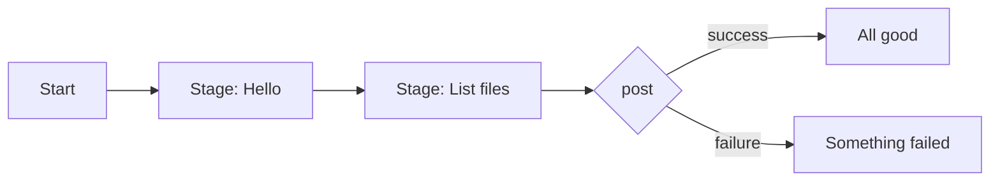
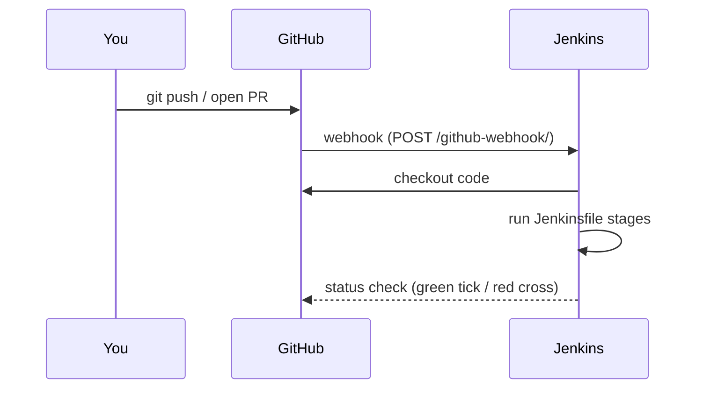

# Chapter 11 — Jenkins and Groovy Basics

**Goal:** Read a `Jenkinsfile`, know what a stage and a credential are, and know how GitHub tells Jenkins to start.

**Time:** about 1 hour  
**You need:** [Chapter 08](08-github-end-to-end-practice.md) and [Chapter 09](09-yaml-basics.md)

---

## 1. What is Jenkins?

Jenkins is an **automation server**. It is a robot that waits for a signal, then runs steps for you: check out code, test it, deploy it.

- **CI** (Continuous Integration): check every change automatically.
- **CD** (Continuous Delivery/Deployment): move the change to the next environment automatically.

## 2. What is Groovy?

Groovy is the programming language Jenkins understands. You write the pipeline steps in a file named **`Jenkinsfile`** (no extension) at the top of your repo. Most teams use the simple **declarative** style, so you write very little real Groovy.

---

## 3. The words

| Word | Simple meaning |
|---|---|
| **Job / Pipeline** | One automation in Jenkins |
| **Jenkinsfile** | The recipe for the pipeline, kept in Git |
| **Agent** | The machine that runs the steps |
| **Stage** | A named group of steps, e.g. "Validate" |
| **Step** | One action, e.g. `sh 'yamllint .'` |
| **Build** | One run of the pipeline, numbered #1, #2... |
| **Credential** | A secret saved in Jenkins (password, token, key), used by ID |
| **Webhook** | A message GitHub sends to Jenkins: "someone pushed" |
| **Multibranch pipeline** | Jenkins makes one pipeline per branch/PR automatically |

---

## 4. The smallest Jenkinsfile

```groovy
pipeline {
    agent any                       // run on any free machine

    stages {
        stage('Hello') {
            steps {
                echo 'Hello Ravi'
            }
        }
        stage('List files') {
            steps {
                sh 'ls -la'          // on Windows agents use: bat 'dir'
            }
        }
    }

    post {
        success { echo 'All good' }
        failure { echo 'Something failed' }
    }
}
```

Read it like a form:

- `pipeline { }` — everything is inside here
- `agent` — where to run
- `stages` — the list of stages, top to bottom
- `post` — what to do at the end



## 5. Groovy bits you will see

```groovy
def envName = 'qa'                 // a variable
echo "Deploying to ${envName}"     // double quotes put the value inside
echo 'Single quotes: ${envName}'   // single quotes do NOT replace it

if (envName == 'prod') {
    echo 'Careful!'
}
```

Other useful parts:

```groovy
environment { AWX_URL = 'https://awx.example.com' }   // variables for all stages
parameters  { choice(name: 'TARGET', choices: ['dev','qa','prod']) }  // a dropdown when you click Build
when { branch 'main' }            // run a stage only on main
input message: 'Deploy to prod?'  // wait for a human to click Proceed
```

---

## 6. Credentials (keep secrets out of Git)

1. In Jenkins: **Manage Jenkins → Credentials → (global) → Add Credentials**.
2. Pick a kind, for example **Secret text** (a token) or **Username with password**.
3. Give it an **ID**, e.g. `awx-token`. The ID is not secret; the value is.

Use it in a Jenkinsfile:

```groovy
withCredentials([string(credentialsId: 'awx-token', variable: 'AWX_TOKEN')]) {
    sh 'curl -s -H "Authorization: Bearer $AWX_TOKEN" https://awx.example.com/api/v2/me/'
}
```

Jenkins hides the value in the log as `****`.

Tip: in `sh` use **single quotes** around the command so the shell, not Groovy, reads `$AWX_TOKEN`. That keeps the secret out of Groovy strings.

---

## 7. Webhook: GitHub starts Jenkins



Set-up (needs the GitHub plugin in Jenkins, and Jenkins reachable from the internet or GitHub Enterprise network):

1. GitHub repo → **Settings → Webhooks → Add webhook**
2. Payload URL: `https://<your-jenkins>/github-webhook/`
3. Content type: `application/json`
4. Events: **Just the push event** (or also Pull requests)
5. In Jenkins create a **Pipeline** or **Multibranch Pipeline** job pointing to the repo, with "GitHub hook trigger for GITScm polling" (for a plain pipeline job).

If Jenkins is inside a company network and GitHub cannot reach it, teams use **polling** (`pollSCM`) instead, or the company's own Git server (like our on-prem one in [Chapter 06](06-idmc-cicd-picture.md)).

---

## 8. Practice

1. In `hello-world` make branch `jenkins-practice`.
2. Add the smallest Jenkinsfile from section 4. Commit, push, PR.
3. If you have a test Jenkins, create a Pipeline job with "Pipeline script from SCM" pointing to that branch. Click **Build Now**. Open **Console Output**.
4. At work: do **not** edit the team's real Jenkinsfile on day one. Read it and match it to the words above.

---

**Next:** [Chapter 12 — GitHub + Jenkins + AWX together](12-github-jenkins-awx-together.md)  
Back to the guide home: [README.md](README.md)
