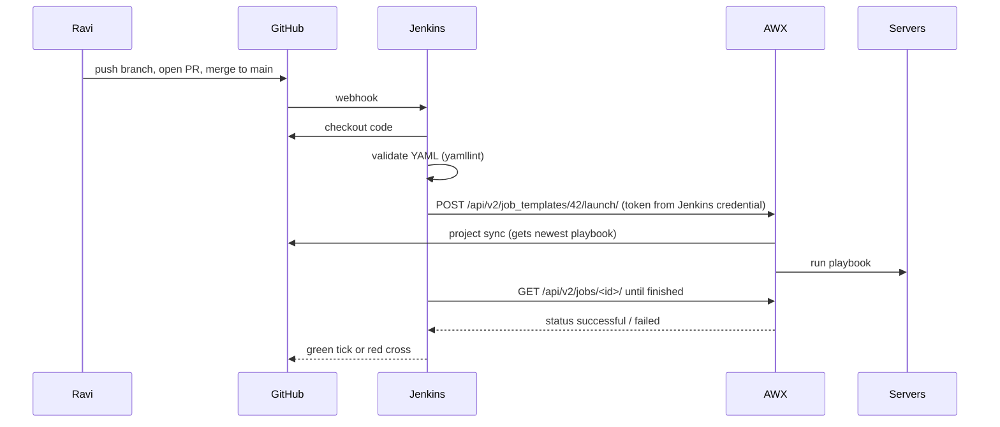
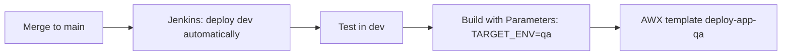

# Chapter 12 — GitHub + Jenkins + AWX Working Together

**Goal:** See the full chain from a commit on GitHub to a job running on servers, with complete sample files you can copy and study.

**Time:** about 1.5 hours  
**You need:** Chapters [09](09-yaml-basics.md), [10](10-ansible-awx-basics.md), [11](11-jenkins-groovy-basics.md)

> These are **learning samples**. Server names, IDs and credential IDs are made up. At work, follow the pipeline your platform team owns (see [Chapter 06](06-idmc-cicd-picture.md)).

---

## 1. Who does what

| Tool | Its job in one line |
|---|---|
| **GitHub** | Keeps the files and history. Sends a webhook when something changes. |
| **Jenkins** | The conductor. Checks out code, runs checks, then asks AWX to deploy. |
| **AWX** | The worker. Runs the Ansible playbook on the servers. |
| **Ansible playbook** | The list of steps that changes the servers. |

## 2. The end-to-end picture



In words:

1. You merge a PR into `main`.
2. GitHub sends a webhook to Jenkins.
3. Jenkins checks out the code and validates every YAML file.
4. Jenkins calls the AWX REST API to **launch a job template**.
5. AWX pulls the newest playbook from GitHub and runs it.
6. Jenkins keeps asking AWX "finished yet?" and fails the build if AWX failed.

---

## 3. Sample repo layout

```text
my-automation/
├── Jenkinsfile
├── .yamllint.yml
├── playbooks/
│   └── deploy_app.yml
└── inventories/
    ├── dev/hosts.yml
    └── qa/hosts.yml
```

---

## 4. Sample Ansible playbook — `playbooks/deploy_app.yml`

```yaml
---
- name: Deploy sample app config
  hosts: app_servers
  become: true
  vars:
    app_dir: /opt/sample_app
    app_version: "1.0.0"          # Jenkins can override with extra_vars
    target_env: dev
  tasks:
    - name: Create app folder
      ansible.builtin.file:
        path: "{{ app_dir }}"
        state: directory
        owner: root
        mode: "0755"

    - name: Write config file
      ansible.builtin.copy:
        dest: "{{ app_dir }}/app.conf"
        content: |
          env={{ target_env }}
          version={{ app_version }}
        mode: "0644"
      notify: Restart app

    - name: Show what was deployed
      ansible.builtin.debug:
        msg: "Deployed {{ app_version }} to {{ target_env }} on {{ inventory_hostname }}"

  handlers:
    - name: Restart app
      ansible.builtin.debug:
        msg: "Here you would restart the service (e.g. ansible.builtin.service)"
```

A **handler** runs only when a task "notified" it, i.e. only if the config really changed.

## 5. Sample `.yamllint.yml`

```yaml
extends: default
rules:
  line-length:
    max: 160
  truthy: disable
```

---

## 6. Example AWX job template setup

| AWX field | Example value |
|---|---|
| Credential (Source Control) | `github-pat-readonly` — GitHub token with read access |
| Credential (Machine) | `deploy-ssh-key` — SSH user `deploy` + private key |
| Project | `my-automation`, Git URL of the repo, branch `main`, **Update revision on launch** ticked |
| Inventory | `dev-inventory`, source from project file `inventories/dev/hosts.yml` |
| Job template name | `deploy-app-dev` |
| Playbook | `playbooks/deploy_app.yml` |
| Variables | `target_env: dev` with **Prompt on launch** ticked |
| Job template ID | e.g. `42` (from the URL) |

For Jenkins, create an **AWX token**: in AWX, open your user (or a service user) → **Tokens → Add**, scope **Write**. Save the value once into Jenkins as a **Secret text** credential with ID `awx-token`. Give that AWX user only **Execute** permission on the templates it needs.

---

## 7. Complete sample `Jenkinsfile` (declarative)

Needs on the Jenkins agent: `curl`, `jq`, Python with `yamllint` (or the stage installs it).

```groovy
// Jenkinsfile - learning sample: GitHub -> validate YAML -> launch AWX job template
pipeline {
    agent any

    options {
        timestamps()
        timeout(time: 60, unit: 'MINUTES')
        disableConcurrentBuilds()
    }

    parameters {
        choice(name: 'TARGET_ENV', choices: ['dev', 'qa'], description: 'Where to deploy')
        string(name: 'APP_VERSION', defaultValue: '1.0.0', description: 'Version label to deploy')
    }

    environment {
        AWX_URL = 'https://awx.example.com'      // change to your AWX
        // One job template per environment (IDs are examples)
        AWX_TEMPLATE_DEV = '42'
        AWX_TEMPLATE_QA  = '43'
    }

    stages {
        stage('Checkout') {
            steps {
                checkout scm        // gets the same commit that started the build
                sh 'git log -1 --oneline'
            }
        }

        stage('Validate YAML') {
            steps {
                sh '''
                    python3 -m pip install --user --quiet yamllint
                    python3 -m yamllint -c .yamllint.yml playbooks/ inventories/
                '''
            }
        }

        stage('Launch AWX job') {
            when { branch 'main' }  // only deploy from main (multibranch pipeline)
            steps {
                script {
                    env.TEMPLATE_ID = (params.TARGET_ENV == 'qa') ? env.AWX_TEMPLATE_QA : env.AWX_TEMPLATE_DEV
                }
                withCredentials([string(credentialsId: 'awx-token', variable: 'AWX_TOKEN')]) {
                    sh '''
                        set -eu
                        BODY=$(jq -n --arg env "$TARGET_ENV" --arg ver "$APP_VERSION" \
                               '{extra_vars: {target_env: $env, app_version: $ver}}')

                        RESPONSE=$(curl -sS --fail-with-body -X POST \
                          -H "Authorization: Bearer $AWX_TOKEN" \
                          -H "Content-Type: application/json" \
                          -d "$BODY" \
                          "$AWX_URL/api/v2/job_templates/$TEMPLATE_ID/launch/")

                        JOB_ID=$(echo "$RESPONSE" | jq -r '.job')
                        echo "AWX job started: $AWX_URL/#/jobs/playbook/$JOB_ID/output"
                        echo "$JOB_ID" > awx_job_id.txt
                    '''
                }
            }
        }

        stage('Wait for AWX job') {
            when { branch 'main' }
            steps {
                withCredentials([string(credentialsId: 'awx-token', variable: 'AWX_TOKEN')]) {
                    sh '''
                        set -eu
                        JOB_ID=$(cat awx_job_id.txt)
                        for i in $(seq 1 120); do     # up to ~20 minutes
                          STATUS=$(curl -sS --fail-with-body \
                            -H "Authorization: Bearer $AWX_TOKEN" \
                            "$AWX_URL/api/v2/jobs/$JOB_ID/" | jq -r '.status')
                          echo "AWX job $JOB_ID status: $STATUS"
                          case "$STATUS" in
                            successful) exit 0 ;;
                            failed|error|canceled) exit 1 ;;
                          esac
                          sleep 10
                        done
                        echo "Timed out waiting for AWX"; exit 1
                    '''
                }
            }
        }
    }

    post {
        success { echo "Deploy to ${params.TARGET_ENV} finished OK" }
        failure { echo 'Build failed - open the Console Output and the AWX job log' }
        always  { archiveArtifacts artifacts: 'awx_job_id.txt', allowEmptyArchive: true }
    }
}
```

What each piece does:

| Part | Why |
|---|---|
| `parameters` | Gives a dropdown when someone clicks **Build with Parameters** |
| `checkout scm` | Takes the exact commit GitHub told Jenkins about |
| `yamllint` | Stops early if a YAML file is broken |
| `withCredentials` | Reads the AWX token safely; it shows as `****` in logs |
| `.../launch/` | AWX REST API call that starts the job template; reply contains the job ID |
| `extra_vars` | Values sent to the playbook (works only if Variables are "Prompt on launch") |
| `.../jobs/<id>/` | Ask AWX for the job status until it finishes |

On the first webhook build the parameters use their defaults (`dev`, `1.0.0`).

Check the API against your AWX version: open `https://<your-awx>/api/v2/` in a browser — it lists the endpoints.

---

## 8. Promote Dev → QA safely



For Prod, teams usually add an `input` step (a human approval) and a separate AWX template with tighter access.

---

## 9. Troubleshooting

| Symptom | Likely cause |
|---|---|
| Build never starts | Webhook not reaching Jenkins (GitHub → Settings → Webhooks → Recent deliveries) |
| `yamllint` errors | Indentation / tabs — see Chapter 09 |
| `401` from AWX | Wrong or expired token, or wrong credential ID |
| `403` from AWX | Token user lacks Execute on the template |
| `400` "variables not allowed" | Turn on **Prompt on launch** for Variables in the template |
| AWX job failed | Open the AWX job output; usually SSH or a task error |

---

**Next:** [Chapter 13 — Informatica IDMC with GitHub](13-idmc-with-github.md)  
Back to the guide home: [README.md](README.md)
