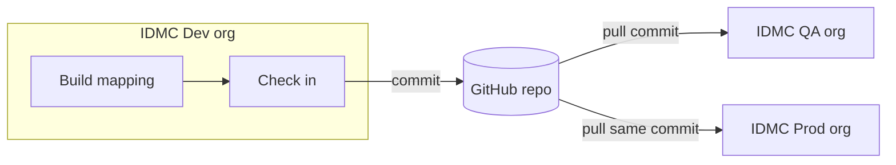
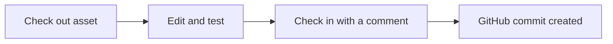
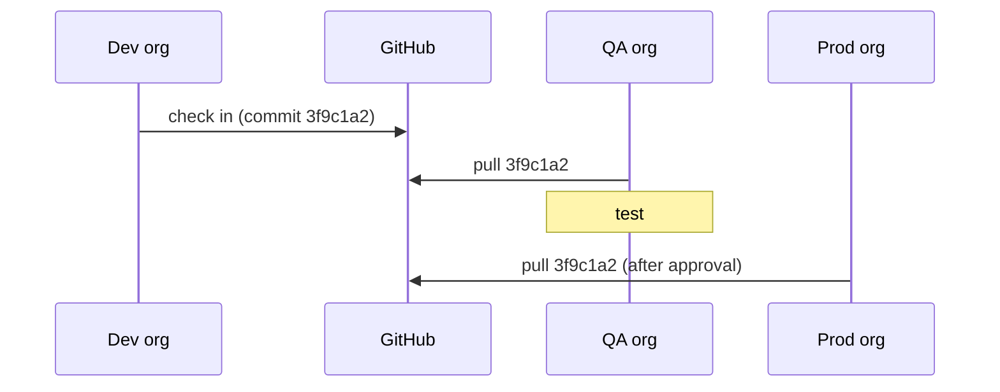
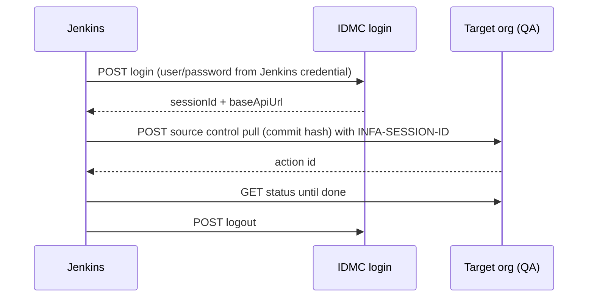

# Chapter 13 — Informatica IDMC with GitHub

**Goal:** Understand how an IDMC org connects to GitHub, how you check in assets, and how you move them from Dev to QA and Prod — by hand and from Jenkins.

**Time:** about 1.5 hours  
**You need:** Chapters [06](06-idmc-cicd-picture.md), [08](08-github-end-to-end-practice.md), [11](11-jenkins-groovy-basics.md)

> **Not an official Informatica document.** It explains the general idea in simple English. Screen names, menu paths and API endpoints change between releases. **Always verify against the current Informatica documentation** (Administrator help: "Source control"; REST API Reference: "Source control" and "Import and export").
>
> Our **work** setup uses an on-prem Git server and a team-owned Jenkins pipeline driven by `flo_<env>.yml` (see [Chapter 06](06-idmc-cicd-picture.md) and [07](07-idmc-dev-to-sit-practice.md)). This chapter is the **general GitHub version** for learning. Do not change work org settings based on this page. For practice orgs, see [idmc-meridian/14](idmc-meridian/14-do-not-mix-with-work-cicd.md).

---

## 1. The words

| Word | Simple meaning |
|---|---|
| **Org** | One IDMC tenant. Usually one org per environment: Dev, QA, Prod |
| **Asset** | Anything you build: mapping, mapping task, taskflow, connection... |
| **Source control** | IDMC feature that saves assets into a Git repo |
| **Check in** | Save the current version of an asset into Git (a commit) |
| **Check out** | Lock an asset so you can edit it while it is under source control |
| **Undo check out** | Release the lock without saving to Git |
| **Pull** | Bring assets from a Git commit into an org |
| **Commit hash** | The long ID of one commit, e.g. `3f9c1a2...` |
| **Runtime environment** | Where jobs run: a Secure Agent group or a serverless runtime |
| **Connection** | Saved login details to a source/target (database, S3, Salesforce...) |
| **PAT** | GitHub personal access token; IDMC uses it to talk to GitHub |

---

## 2. The big picture



One repo. Dev **writes** to it. QA and Prod **read** from it by pulling a specific commit. The same commit hash means the same versions of the assets.

---

## 3. Connect an org to GitHub (one time per org)

Usually an org admin does this. The general steps:

1. **On GitHub:** create a repo (e.g. `idmc-assets`). It can be empty with a README. Create a **personal access token** for a user who can write to it (fine-grained token with "Contents: read and write" on that repo is the tightest choice; classic token with `repo` scope also works). Some IDMC versions also support OAuth instead of a token — check your docs.
2. **In IDMC Administrator:** open **Organization settings** (or **Settings**) and find the **Source Control** section. Select the provider (GitHub), enter the repo URL and the default branch, and save. Wording and options vary by release, e.g. "Allow Push to Git Repository" or "Enable Project Level Source Control" (you saw those in Chapter 06).
3. **Each user links their own Git account:** in IDMC, under your user profile / settings, enter your GitHub username and PAT so check-ins are recorded under your name. (Location of this setting varies; check the Informatica docs for "Git credentials" or "source control credentials".)
4. Repeat for QA and Prod orgs, pointing to the **same repo**. Many teams give the Prod org **read-only** access (pull, no check in).

Security: the PAT is a password. Store it only in IDMC and in Jenkins credentials. Set an expiry date. Revoke it if it leaks.

---

## 4. Daily work in the Dev org



1. In **Data Integration → Explore**, select the project/folder or asset.
2. Use the action menu for **Check Out** (if the asset is already in source control).
3. Edit, save, and test the mapping task.
4. **Check In**: select the assets (and their dependencies if offered), write a clear comment like `JIRA-123 add customer filter`, and confirm.
5. On GitHub, open the repo → **Commits**. You will see the new commit and the asset files (mostly JSON/metadata, not easy to read — that is normal).
6. Copy the **commit hash**. That is what you promote.

Tips:

- Check in a whole project folder for a release, so dependencies travel together.
- Do not edit asset files directly on GitHub. Let IDMC write them.

---

## 5. Promote Dev → QA → Prod by pulling a commit

In the **target** org (QA first):

1. Make sure the same project/folder exists (or let the pull create it — depends on version).
2. Open Explore, choose **Pull** (from the source control menu).
3. Choose the **commit** (by hash or from the list).
4. Review the list of assets. Map/confirm **connections** and **runtime environments** if asked.
5. Confirm. Watch **My Import/Export Logs** or the source control log for the result.
6. Run a smoke test in QA. If good, repeat in Prod with **the same commit hash**.



---

## 6. Connections and runtime environments per org

Assets **refer to** a connection and a runtime by **name**. The real details (host, user, password, agent) differ per org.

| Item | Dev org | QA org | Prod org |
|---|---|---|---|
| Connection name | `ORA_SALES` | `ORA_SALES` | `ORA_SALES` |
| Host inside it | dev-db | qa-db | prod-db |
| Runtime name | `SA_GROUP_01` | `SA_GROUP_01` | `SA_GROUP_01` |
| Agent machine | dev-agent | qa-agent | prod-agent |

Good habits:

- **Create connections and runtimes in each org by hand first**, with the **same names**. Keep passwords out of Git.
- Many teams **do not promote connections** at all — only mappings, tasks and taskflows.
- Use **parameter files** or in-out parameters for things that change per environment (paths, schema names). See [idmc-meridian/06](idmc-meridian/06-parameters.md).

---

## 7. Alternative: export / import (no Git)

If source control is not set up, IDMC can **export** assets to a ZIP file and **import** that ZIP in another org.

1. Dev org → Explore → select assets → **Export**. Download the ZIP.
2. Target org → Explore → **Import** → upload the ZIP → map connections/runtimes → import.
3. You can commit the ZIP to GitHub to keep a history of releases.

| | Source control pull | Export / import |
|---|---|---|
| History | Every check-in is a commit | Only what you save |
| Who did what | Recorded per user | Manual notes |
| Automation | Pull API | Export/import API, or the Informatica CLI used by many CI/CD pipelines |
| Set-up | Repo + PAT per org/user | None |

Our work pipeline in Chapter 06 uses Informatica's command line tool from Jenkins, which is in the export/import family.

---

## 8. Automate promotion from Jenkins (REST API)

The idea: Jenkins logs in to the target org, asks it to **pull a commit**, waits, and reports the result.



> **Endpoints below are examples** based on the IDMC v3 REST API at the time of writing. Check paths, body fields and the login host for your **pod/region** in the current **Informatica REST API Reference** before using them.

| Step | Example call |
|---|---|
| Login | `POST https://dm-us.informaticacloud.com/saas/public/core/v3/login` body `{"username":"...","password":"..."}` → returns `userInfo.sessionId` and `products[0].baseApiUrl` |
| Pull a commit | `POST <baseApiUrl>/public/core/v3/pull` header `INFA-SESSION-ID: <id>` body `{"commitHash":"3f9c1a2..."}` → returns an id |
| Check status | `GET <baseApiUrl>/public/core/v3/sourceControlAction/<id>` |
| Import instead | `POST <baseApiUrl>/public/core/v3/import` (upload ZIP) then `POST .../import/<jobId>` to start, `GET .../import/<jobId>` for status |
| Logout | `POST https://dm-us.informaticacloud.com/saas/public/core/v3/logout` |

Use a **service user** in each org with only the rights it needs. Save its login in Jenkins as **Username with password**, e.g. ID `idmc-qa-svc`.

### Sample Jenkinsfile stage

```groovy
// Learning sample - verify endpoints against current Informatica REST API docs
pipeline {
    agent any
    parameters {
        string(name: 'COMMIT_HASH', description: 'GitHub commit to promote (from Dev check-in)')
        choice(name: 'TARGET_ORG', choices: ['qa', 'prod'], description: 'Org to pull into')
    }
    environment {
        IDMC_LOGIN_URL = 'https://dm-us.informaticacloud.com/saas'   // your pod/region login host
    }
    stages {
        stage('Approval for prod') {
            when { expression { params.TARGET_ORG == 'prod' } }
            steps { input message: "Pull ${params.COMMIT_HASH} into PROD?" }
        }
        stage('Promote to IDMC org') {
            steps {
                script {
                    env.CRED_ID = (params.TARGET_ORG == 'prod') ? 'idmc-prod-svc' : 'idmc-qa-svc'
                }
                withCredentials([usernamePassword(credentialsId: env.CRED_ID,
                                                  usernameVariable: 'IDMC_USER',
                                                  passwordVariable: 'IDMC_PASS')]) {
                    sh '''
                        set -eu
                        # 1. Login
                        LOGIN=$(jq -n --arg u "$IDMC_USER" --arg p "$IDMC_PASS" '{username:$u, password:$p}' |
                          curl -sS --fail-with-body -X POST -H "Content-Type: application/json" \
                               -d @- "$IDMC_LOGIN_URL/public/core/v3/login")
                        SESSION=$(echo "$LOGIN" | jq -r '.userInfo.sessionId')
                        BASE=$(echo "$LOGIN"    | jq -r '.products[0].baseApiUrl')

                        # 2. Ask the target org to pull the commit
                        PULL=$(curl -sS --fail-with-body -X POST \
                          -H "Content-Type: application/json" -H "INFA-SESSION-ID: $SESSION" \
                          -d "{\\"commitHash\\": \\"$COMMIT_HASH\\"}" \
                          "$BASE/public/core/v3/pull")
                        ACTION_ID=$(echo "$PULL" | jq -r '.pullActionId // .id')
                        echo "Pull started, action id: $ACTION_ID"

                        # 3. Wait for the result
                        RESULT=FAILED
                        for i in $(seq 1 60); do
                          STATE=$(curl -sS -H "INFA-SESSION-ID: $SESSION" \
                            "$BASE/public/core/v3/sourceControlAction/$ACTION_ID" | jq -r '.status.state')
                          echo "State: $STATE"
                          case "$STATE" in
                            SUCCESSFUL) RESULT=OK; break ;;
                            FAILED|WARNING) break ;;
                          esac
                          sleep 10
                        done

                        # 4. Logout (always)
                        curl -sS -X POST -H "INFA-SESSION-ID: $SESSION" "$IDMC_LOGIN_URL/public/core/v3/logout" || true
                        [ "$RESULT" = OK ]
                    '''
                }
            }
        }
    }
}
```

Notes:

- Field names like `pullActionId` and `status.state` are **examples** — print the raw JSON once (`echo "$PULL"`) in a test org and adjust.
- You can also start an IDMC job after the pull (e.g. a smoke-test mapping task) with the job API — see the REST API reference.

---

## 9. Checklist before your first real promotion

- [ ] Same project/folder names in Dev, QA and Prod
- [ ] Connections and runtimes exist in the target org with the **same names**
- [ ] PAT / service user stored only in IDMC and Jenkins credentials
- [ ] I know the exact commit hash I am promoting
- [ ] I tested the pull in QA before Prod
- [ ] I followed the team's change process (ticket/approval)

---

**Next:** [Chapter 14 — New words for CI/CD and IDMC](14-glossary-cicd-idmc.md)  
Back to the guide home: [README.md](README.md)
